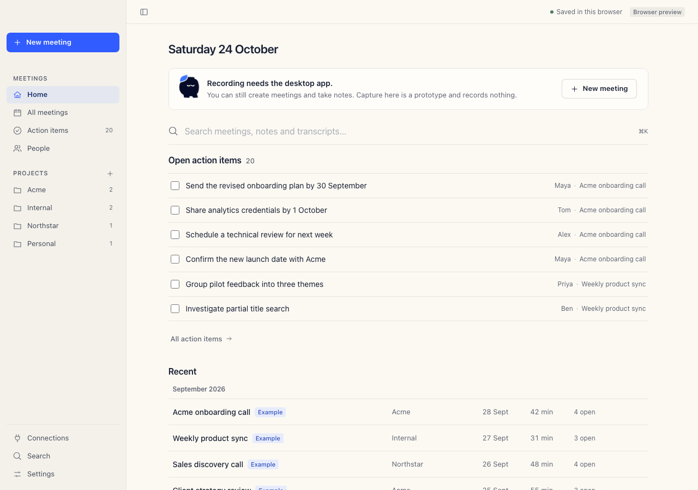

# QuietNote

A calm, local-first meeting workspace built **on Scratch by Eric Li**, not a replacement editor built from scratch. Meetings are the primary object. On macOS and Windows, QuietNote records your microphone and the call audio when you press start, and transcribes it on the device with a bundled Whisper model, removing filler words like "um" and "uh" while keeping the original words. There are no bots, cloud sync or accounts. Summary suggestions are off by default; when you turn them on and ask, Claude (with your own Anthropic key) or a model in Ollama on your computer drafts them from the transcript, and nothing is saved until you add it. The only network use is an explicit send of action items to a Linear or GitHub account you connected, or of a transcript's text to Anthropic when you ask Claude for suggestions.



## Run

Requires Node 22+ and npm. The desktop app additionally needs Rust and the platform prerequisites for Tauri 2.

```sh
npm ci
npm run dev          # browser preview at http://localhost:1420
npm run tauri dev    # real desktop filesystem + native shell
npm run tauri build  # platform desktop bundle
```

`npm run tauri dev` and `npm run tauri build` first run `npm run models`, which downloads the speech models (about 575 MB, plus about 140 MB on macOS for telling voices apart and the faster English live transcript, all checked against pinned SHA-256 hashes) into `src-tauri/resources/models/`, and on macOS the sherpa-onnx library those run on into `src-tauri/resources/sherpa/`. Run it once before building on macOS with `cargo` directly. This happens once, at build time; the app itself downloads nothing. Building the recorder needs CMake (and LLVM/clang on Windows) for whisper.cpp. The macOS app requires macOS 14.6 or later.

A verified macOS development bundle is produced at `src-tauri/target/debug/bundle/macos/QuietNote.app`. It is a local development build, not a signed/notarized distribution release.

For this implementation session, Rust was installed only under `/private/tmp/quietnote-cargo` and `/private/tmp/quietnote-rustup`, without modifying the global PATH. Until those temporary directories are cleared, native commands can be run as:

```sh
CARGO_HOME=/private/tmp/quietnote-cargo \
RUSTUP_HOME=/private/tmp/quietnote-rustup \
PATH=/private/tmp/quietnote-cargo/bin:$PATH npm run tauri dev
```

## What works

- **First launch** is a single screen: create your first project, or explore six example meetings (badged *Example*). New archives start empty; nothing is seeded without asking.
- **Projects** are created in one step (a name) and map to folders in the archive. **New meeting** asks only for an optional title and a project. Where recording is available its main button is *Start recording*; *Create meeting* makes it without recording.
- **Home** answers three questions, and hides any section with nothing to show:
  - *Can I record now?* A card reports the microphone permission, the speech model and any recording or transcription in progress, with the fix beside a problem. Its Start recording opens New meeting.
  - *What do I owe people?* Open action items from every meeting, as checkboxes that write back to each `meeting.md`, with the owner and the meeting they came from; *All action items* opens the Action items page.
  - *What happened lately?* The ten latest meetings.

  A search field opens Search with what you type. There's no AI chat: it finds what was said and doesn't generate anything.
- **Library**: Home, All meetings and per-project views. Rows show title, project, date (the time for today's meetings) and duration, grouped as Today / Yesterday / Previous 7 days / month. Status appears only while something is happening or needs attention (Recording, Transcribing, Needs attention). Otherwise the row shows how many action items are still open.
- **Meeting workspace**: sticky title and two tabs, Notes and Transcript, as in Granola. Notes switches between *Enhanced notes* and *My notes*. Enhanced notes start with the meeting's action items (added inline; `Owner — task` sets an owner), followed by the summary or the enhanced write-up. Tasks stay Markdown checkboxes. A meeting opens on its enhanced notes once it has some (or a transcript), otherwise on your own notes.
- **Hush**: a small character whose face shows what QuietNote is doing (ready, listening, paused, transcribing, drafting, done, needs attention, resting) on the Home card, the call panel, the macOS menu bar, a meeting's transcribing and problem notices, the drafting notice, the *Recording saved* / *Transcript ready* banner and empty states, one per screen. Settings → Appearance → *Show Hush* turns it off and brings back the status dot and logo. Every mood is a real state; while recording, its eyes turn to whoever the levels say is talking. It holds still when macOS's Reduce motion is on.
- **Action items** (sidebar, with the open count): every meeting's action items under the meeting they came from, open or done; ticking one writes it to that meeting's `meeting.md`.
- **Notes** use Scratch's **actual TipTap Editor**, with formatting, Markdown source, slash commands, tables, code, math and find.
- **Recording** (macOS and Windows): *Start recording* on a meeting starts at once, opens the meeting's Notes and pins a recorder bar to the bottom of the meeting with the recorded time, whether the mic and the call audio are coming through, the microphone to use, *Pause* and *Stop*. Pausing releases the microphone until *Resume*; paused time isn't recorded or counted. On macOS a recording also pauses when the Mac goes to sleep (and waits for *Resume*), and music that's playing pauses when recording starts. The bar's details show a live transcript on macOS: words appear a few seconds after they're spoken, transcribed on the Mac, as a draft until the full transcript replaces it after Stop; in English meetings a faster model (Parakeet) takes over and shows words about a second after they're said, including the sentence still being spoken (Settings → Privacy turns it off; it uses up to 700 MB more memory while recording). Next to "Let everyone know you're recording", *Copy message* copies a short consent note to paste into the call's chat. Nothing covers the notes or the transcript. A finished meeting can record more with *Resume recording*; the new part is added to its transcript. Recording from the *Meeting detected* panel turns the window into a narrow column beside the call with just the meeting (notes, recorder, live transcript); *Open full window* puts it back. The microphone and the system audio (what the computer plays, so the other people on the call) are written as two 16 kHz WAV tracks in the meeting's `audio/` folder. System audio comes from a Core Audio tap on macOS ("System Audio Recording" permission, no screen recording) and WASAPI loopback on Windows. Nothing joins the call. Before the first recording, the bar explains both macOS permissions and waits for Start, so the explanation comes before the system prompts; a denied microphone shows what failed with *Open System Settings* and *Try again*. While recording, every other view shows a recording bar (title, recorded time, *Resume* while paused, Stop), and the menu bar / system tray shows the same meeting, "Started … by you · No bot joined", the recorded time, *Pause recording* (or *Resume recording*) and *Stop recording*. The tray's *Start recording…* opens New meeting; recording starts only from its button, and only one meeting records at a time. If a device disappears or stops delivering audio (unplugged headset, AirPods switching away), QuietNote says so ("Microphone disconnected", "Microphone changed to …") and reconnects to the chosen microphone or the current default device; audio already captured is kept. A silent track after 20 seconds shows a hint (usually a permission). While recording, the tray menu shows only the recording and its controls. Stopping in the meeting replaces the bar with the transcription progress; stopping elsewhere shows *Recording saved* with Open meeting, then *Transcript ready*. Quitting from the tray while recording reads *Stop recording and quit*.
- **Local transcription**: when recording stops, the meeting shows *Transcribing on this Mac… 42%*. whisper.cpp runs the bundled Whisper large-v3-turbo model with voice activity detection, on Metal on Apple silicon and the CPU on Windows. Mic speech is labelled *You* and system audio *Others*. On speakers the microphone hears the call too, so the call audio is cancelled out of the mic track while recording (WebRTC's echo canceller), and any echo left over is dropped from the transcript. On macOS the others' voices are then told apart on the Mac, so a call with several people reads *Speaker 1*, *Speaker 2*… (grouped by sound; nobody is identified). If it fails, the meeting says *Transcription couldn't finish. Your recording is still saved*, with the reason under Details, and *Retry transcription* retries (audio is never deleted on failure). A missing or damaged model is reported before recording and checked by SHA-256 before transcribing; there is never a fallback transcript.
- **Stopping when the call ends**: when the call app that was using the microphone lets go of it (you left the call), or after 15 minutes with nothing heard, the recorder, the window bar, the tray and the call panel show *Recording stops in 0:59* with *Keep recording*. It stops only once nobody has been heard for 10 seconds, so talking on after the call keeps recording.
- **Last time**: before and during a meeting, its Notes start with what the previous meeting of the series (or of the project) left open: its open action items, which you can tick off there.
- **Enhance notes** (with summary suggestions on): your notes are written up under a template (General, 1:1, Standup, Sales call, User interview, Project kickoff, or your own Markdown templates) and filled in from the transcript. Every line quotes your notes or the transcript, anything that can't be traced is left out, and nothing is saved until you choose *Use as summary*. Lines from the transcript keep their time and open the transcript there.
- **Calendar** (macOS, off until you turn it on in Settings → Privacy): QuietNote reads the calendars on your Mac (Google, Outlook and iCloud accounts added to it) through Apple's EventKit. Home shows *Up next* with *Prepare notes*, the menu bar shows the next meeting, New meeting and a recorded call take the event's title, project and who's invited, and a weekly meeting's notes follow last week's. It never changes your calendar or starts recording, and nothing is sent anywhere.
- **People**: everyone you meet, from invites, grouped by company (email domain). A person's or company's page lists the meetings they were in and the open action items they own.
- **Names**: rename a meeting by pressing its title, and a voice in the transcript by pressing its label ("Speaker 2" → "Sam Lee"; the words don't change). With one other person invited, QuietNote offers their name for the other voice. With summary suggestions on, *Name the meeting and speakers…* suggests a title and names, each name with the line that shows it (someone introducing themselves or being addressed); it sends the transcript and the invited names, and nothing changes until you use a suggestion.
- **Command line** (read-only): `quietnote meetings`, `quietnote show <meeting>`, `quietnote transcript <meeting> [--verbatim]`, `quietnote search <words>` and `quietnote projects` print the archive in Terminal; they never change it and don't need the app running. Settings → Local archive → Advanced copies the one-line setup (a link to the app's binary in `/usr/local/bin`). `quietnote mcp` serves the same, read-only, to Claude Desktop, Claude Code or another MCP app; Settings → Local archive → Advanced copies its configuration.
- **Filler words**: like Wispr Flow, QuietNote keeps what was said and shows a cleaned version. Unlike Wispr it runs no LLM and sends nothing anywhere: cleanup is delete-only and rule-based. It removes "um", "uh", "erm", "hmm" and stutters ("I I I think", "we should we should"), fixes the punctuation and capitalization this leaves, and keeps words whose meaning depends on context ("like", "you know", "I mean", "actually"). It never merges self-corrections, because in a meeting that could be two people. The Transcript tab switches between *Clean* and *Verbatim*. The browser preview (and Linux) keep a prototype capture that records nothing.
- **Summary suggestions** (desktop, off by default; Settings → Privacy → *Drafted by*): on a recorded meeting, *Suggest from transcript…* first says exactly what happens (with Claude: "About N words of transcript text go to Claude with your key. The audio, your notes and the meeting's title stay on this Mac."; with Ollama: it runs on this computer), then drafts a summary and action items. Every action item must cite a transcript line by its timestamp with an exact quote; anything that can't be traced is left out, and the panel says how many. Owners are kept only when they're *You* or a name someone said. Clicking a quote opens the Transcript at that line. Each item is *Add* or *Dismiss*; nothing is written until you add it. The Anthropic key is checked, then kept in the macOS Keychain and never returned to the window. Claude requests use Claude Opus 5.5 with Anthropic's server-side refusal fallback; Ollama meetings longer than its 32k-token context are refused, not cut.
- **Search** (Cmd/Ctrl+K) covers titles, enhanced notes, action items, your notes and transcripts. Results show context with the match highlighted and open the meeting where the match was found (a transcript match opens filtered to the phrase). Enter opens the first result.
- **Connections** (sidebar) is a searchable directory of services. Linear and GitHub work today: sign in through your browser (Linear redirects back to QuietNote; GitHub shows a code to enter on its page), or paste a personal key. QuietNote checks the account and keeps the access in the macOS Keychain, never on a server, then use *Send to…* on a meeting's Action items to create issues. Only each item's text and owner, plus the meeting's title, date and project, are sent. The issue link is written back onto the action item's Markdown line. Example meetings can't be sent. Every other service (Zoom, Google Meet, Teams, calendars, Jira, Asana, Todoist, Things, Reminders, Gmail, Slack, Notion, Obsidian, Google Docs) is listed as *Planned* and does nothing. The browser preview can't connect.
- **How Connections differ from cloud assistants.** Assistants like Grok connect services through cloud OAuth: after one sign-in their servers can reach your data on demand, and custom connectors must be public MCP servers. QuietNote does the opposite. Keys stay in your Mac's Keychain, requests go from your Mac only when you press Send, and there is no QuietNote server. Planned sign-in connectors (Google, Microsoft, Slack, Notion) would use native-app OAuth (system browser, PKCE, loopback redirect) with tokens kept on the Mac. Meeting-platform entries never join a call; they would only notice a call locally and offer to start capture.
- **Privacy** lists what is true today and the enforced *Remove filler words* and *Delete audio after transcribing* switches. The browser preview also shows *Planned* preferences, which are saved but have no effect; the desktop app with recording hides them. Cloud processing is unavailable.
- **Local archive** settings: Open archive, Reload from disk, and an Advanced section with the path, the Markdown workspace and example meetings.
- **Recovery**: per-keystroke drafts, serialized writes and native close handling. A failed save shows "Your latest changes haven't been saved to disk" with Retry and Reload saved version. Drafts from a previous session are offered back as *Save now* or *Discard*. Files changed outside QuietNote raise an explicit Refresh prompt; QuietNote's own saves don't. A recording cut short by a crash is recovered from its audio (the WAV files are checkpointed every second): the next launch shows a *Recovered recording* banner and a notice in the meeting saying what was saved and whether the transcript was recovered or failed (with the audio kept). If transcription itself crashes QuietNote twice, the meeting waits for the user instead of retrying at every launch. One with no audio reopens as *Needs attention* with Add notes and Mark as ended.
- **Returning**: QuietNote reopens the last view, meeting and tab.
- **Keyboard**: Cmd/Ctrl+N new meeting; Cmd/Ctrl+K (or P, or Shift+F) search; Cmd/Ctrl+, settings; Cmd/Ctrl+\\ or Cmd/Ctrl+Shift+Enter hide the sidebar; Cmd/Ctrl+Shift+M Markdown source in the editor; Esc closes dialogs; arrow keys move between meeting tabs. Cmd/Ctrl+K inside the editor still inserts a link.
- **Narrow windows**: below 720px the sidebar becomes an icon rail with project initials; no horizontal scrolling.

## Reused from Scratch

The Tauri 2 desktop shell, React/Vite foundation, Rust filesystem commands, folder operations, file watcher, Tantivy search with fallback, TipTap editor and Markdown serialization, theme provider, formatting and keyboard tools remain in place. The retained generic workspace is available from **Settings → Local archive → Open Markdown workspace** on desktop (`?workspace=markdown`). Return through its Settings → About → Return to QuietNote meetings. Standalone Markdown file previews still use the upstream preview route.

The full pre-change audit is in [docs/SCRATCH-AUDIT.md](docs/SCRATCH-AUDIT.md). Original source files remain unless replaced by working QuietNote equivalents. AI-provider tools, Git tools and generic note operations remain secondary in that advanced workspace; QuietNote does not automatically invoke them.

## What changed

The new shell lives in `src/quietnote/`. Default navigation is New meeting, Home, All meetings, Projects, Search and Settings. Notes are one meeting tab. Projects are top-level archive folders. The new `src-tauri/src/meetings.rs` module lists projects, creates project folders and meeting bundles, reads them and persists metadata/preferences; Markdown edits reuse Scratch's file service. The interaction rationale is in [docs/UX-AUDIT.md](docs/UX-AUDIT.md).

Warm paper, navy, cobalt and mint tokens match the existing QuietNote landing page. The QuietNote logo replaces Scratch's icon and sidebar mark; App/window/package metadata and visible legacy workspace branding are updated. Scratch's automatic update feed is disconnected; draft-release automation is manual and uses QuietNote naming. No release was published.

## File model and location

Desktop source of truth:

```text
<platform app data>/app.quietnote.desktop/meetings/
  .initialized                    # written by earlier builds only
  .privacy.json
  .scratch/settings.json          # retained Scratch settings compatibility
  Acme/
    2026-09-28-acme-onboarding/
      metadata.json
      meeting.md
      transcript.md               # cleaned (or verbatim) turns, rendered from transcript.json
      transcript.json             # recorded meetings: raw recognized words + filler deletions
      audio/mic.wav               # recorded meetings: your microphone, 16 kHz mono
      audio/system.wav            # recorded meetings: the call audio
  Northstar/...
  Internal/...
  Personal/...
```

The exact platform path is shown in Settings. On macOS it is:

```text
~/Library/Application Support/app.quietnote.desktop/meetings/
```

On Windows/Linux, Tauri resolves the platform app-data directory. The separate QuietNote identifier isolates this archive from an existing Scratch installation.

`meeting.md` contains title/date/project/duration, Summary, Action items and a final Notes section (meetings from earlier versions may also have a Decisions section, which is shown in the enhanced notes). Notes consumes the remainder of the file, so headings inside manual notes are preserved. Tasks use `- [ ]` / `- [x]`. Transcript text lives **only** in `transcript.md` (and, for recorded meetings, its raw source `transcript.json`, which keeps every recognized word with the byte ranges cleanup removes). Turns are `### mm:ss Speaker`, with *You* for the microphone and *Others* for the call audio. Metadata has `id`, `title`, `date`, duration in **seconds**, project, participants, status (`idle | recording | processing | ready | error`), capture timestamps, the audio folder (`<Project>/<id>/audio`, or null), relative transcript/meeting paths and tags. The preview's simulated capture holds only its measured duration; no audio file is fabricated.

New archives start empty. Example meetings are written only when you choose *Explore example meetings* (first launch) or *Add examples* (Settings → Local archive → Advanced), and existing meeting directories are never overwritten. Archives created by earlier builds keep their demo meetings, which are recognised and badged Example. Metadata and preferences use atomic file replacement; Markdown writes use the retained Scratch direct-file save command. These are separate files, not a transactional database. On desktop, a meeting left in `recording` with audio is recovered (WAV headers repaired, duration taken from the audio) and transcribed, one left in `processing` is transcribed again, and one without audio becomes `error` (*Needs attention*). In the browser preview, such a meeting shows as *Needs attention* until you choose *Mark as ended*. Nothing is resumed or fabricated.

Browser preview is explicitly labeled and uses `localStorage`, not desktop files. Recovery drafts also use local webview storage until committed to the archive. Browser data is specific to its origin; it does not automatically migrate into the desktop app. Corrupt or unavailable archives produce a visible error instead of silently resetting data. External file changes are loaded using the refresh button; concurrent editing in another application does not have conflict merging.

## Boundaries

All demo transcripts and summaries are authored examples. A new meeting's Summary and Action items stay empty until you add something; the UI says *No enhanced notes yet* rather than inventing content. There are no automatic summaries: suggestions are drafted only when you ask, and only what you add is saved. There is no cloud processing apart from that opt-in request to Anthropic, and no retention engine; *Keep meeting data* is a planned preference that stores intent only. Speakers are *You*, and *Others* or (on macOS) *Speaker 1*, *Speaker 2*…; names aren't read from the call app. Filler removal is English and rule-based, so it leaves context-dependent fillers ("like", "you know") in place. The browser preview and Linux keep the prototype capture, which records nothing. Windows builds but hasn't been run: see [docs/WINDOWS.md](docs/WINDOWS.md). Real-device checks are in [docs/QA-RECORDING.md](docs/QA-RECORDING.md) and measurements in [docs/PERFORMANCE.md](docs/PERFORMANCE.md). There is no QuietNote account, server, CRM or collaboration system. The calendar is read on the Mac only while turned on. Connections are limited to user-initiated Linear and GitHub issue creation, signed in through the browser or with a pasted key; there is no background sync or inbound data. A supporter or commercial license is optional, unlocks no features, and is checked once with Lemon Squeezy when you enter its key.

## Checks and screenshots

```sh
npm run lint       # new shell, browser tests and tooling; upstream had no ESLint setup
npm run typecheck  # entire existing and new frontend
npm test           # Playwright interaction/persistence and Markdown-model tests
npm run build
cargo test --manifest-path src-tauri/Cargo.toml
# Run the bundled model on a folder with mic.wav and/or system.wav (16 kHz mono):
QUIETNOTE_TEST_AUDIO=/path/to/audio cargo test --release --manifest-path src-tauri/Cargo.toml transcribes -- --ignored --nocapture
# Score the whole job on real meetings with a known transcript (AMI corpus, about 600 MB of downloads):
node scripts/fetch-ami.mjs
QUIETNOTE_TEST_ACCURACY=test-audio/ami cargo test --release --manifest-path src-tauri/Cargo.toml measures_accuracy -- --ignored --nocapture
npm run tauri build -- --debug --bundles app  # macOS development bundle
```

Install a Playwright Chromium browser with `npx playwright install chromium` if one is not already cached. Tests use fresh browser contexts and do not modify the real desktop archive. Native tests write isolated temporary bundles.

[Validation results](docs/VALIDATION.md) include the actual checks performed. [Screenshot gallery](docs/SCREENSHOTS.md) links library, summary, active capture, privacy, manual notes and transcript views. Browser screenshots deliberately retain their preview/prototype labels. [Exact file manifest](docs/MODIFIED-FILES.md) lists every tracked modification and added file relative to upstream, excluding ignored dependencies and build outputs.

## License and attribution

QuietNote is licensed under the GNU Affero General Public License, version 3 ([LICENSE](LICENSE)). Scratch is by Eric Li and contributors, declared MIT in its upstream README; the code that comes from Scratch remains available under MIT. The audited checkout did not include a separate LICENSE file. Its README is preserved verbatim in [docs/UPSTREAM-README.md](docs/UPSTREAM-README.md); [NOTICE](NOTICE) carries the MIT text with explicit upstream attribution and documents provenance. Both files ship inside the app. Attribution is visible in both QuietNote privacy settings and the retained Markdown workspace's About screen. No original license/copyright file was removed.
