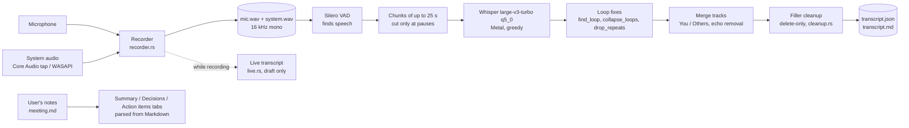
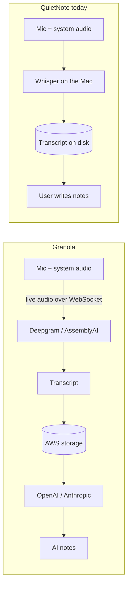
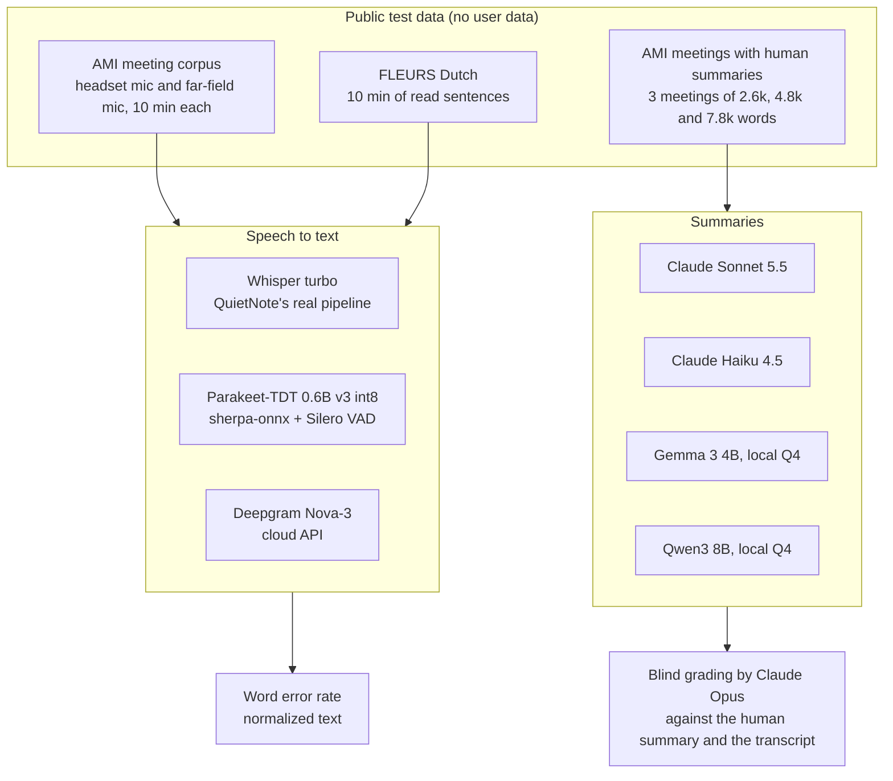
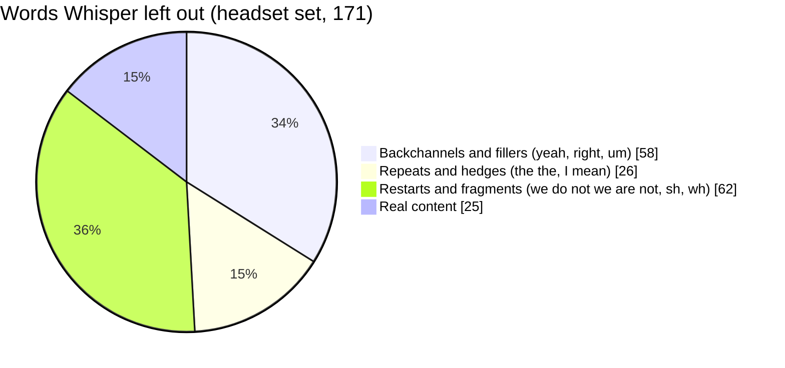
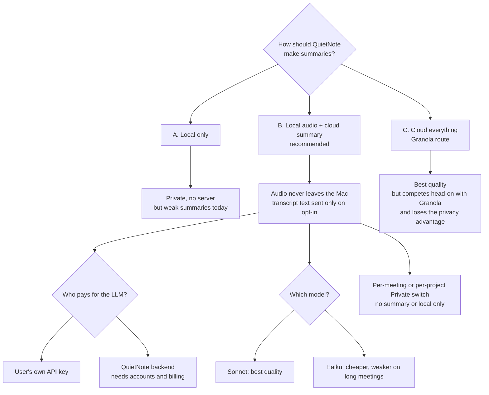

# Model research: transcription and summaries

Research done on 29–30 September 2026: how Granola works, whether QuietNote's local models hold up against cloud services, and why Whisper seemed to drop words. This file records what was tested, what came out, and which decisions are still open.

All numbers come from single runs on one machine (MacBook Pro, M3 Pro, 18 GB RAM, macOS 26.6). They show the size of each gap, not exact values.

## 1. What QuietNote does today

Everything runs on the Mac. Nothing is sent anywhere, except action items the user sends to Linear or GitHub.

There is **no AI summarization**. The Summary, Decisions and Action items tabs show what the user wrote in `meeting.md`.

## 2. How Granola works (checked on their own pages)

A pasted research report said Granola's "runs locally" means the app captures audio locally, not that it transcribes locally. Granola's own documentation confirms this:

- The transcription docs say: "Granola passes audio directly from your microphone and system audio to our transcription provider."
- The network docs list the transcription hosts: `api.deepgram.com`, `d315810d.api.deepgram.com`, `*.api.deepgram.com`, `streaming.us.assemblyai.com`, `streaming.assemblyai.com` and `streaming.eu.assemblyai.com`, all over secure WebSockets on TCP 443.
- The security page names "Deepgram and Assembly" for transcription and "OpenAI and Anthropic" for AI. Notes are stored in "our US-hosted AWS Virtual Private Cloud".
- A job posting (Product Engineer, Transcription) lists "Local transcription models" among its responsibilities. It has no date and no model name.
- Granola's marketing pages ("transcribes audio in real time on your device") contradict these technical docs.
- Not confirmed: a Deepgram testimonial from Granola's CTO. Deepgram's homepage only shows Granola's logo.

**Takeaway:** Granola is also bot-free, so "no bot" alone does not set QuietNote apart from it. What sets QuietNote apart is that audio, transcripts and notes never leave the Mac, with no account and no server.

## 3. Test setup

- All three meeting summaries used the same prompt and the same output format as QuietNote's tabs: Summary, Decisions, and Action items as `- [ ] Owner — task`.
- The grader saw the four candidates under shuffled labels A–D.

## 4. Results

### 4.1 Speech to text

Word error rate (lower is better) on 10 minutes of audio per set.

| Set | Whisper turbo (local) | Parakeet v3 (local) | Deepgram Nova-3 (cloud) |
|---|---|---|---|
| English, headset mic | 18.2% | 20.3% | **11.6%** |
| English, far-field mic (laptop in room) | **38.9%** | 39.7–41.2% | 40.9% |
| Dutch | **6.9%** | 12.4–13.6% | 10.3% |

| | Whisper turbo | Parakeet v3 |
|---|---|---|
| Time per 10 min of audio | 26–30 s (Metal GPU) | 17–23 s (CPU) |
| Peak memory | 730–830 MB | 1.1–1.4 GB |

- **Parakeet is not an upgrade.** It is less accurate everywhere and much weaker in Dutch, and it uses more memory. It is only faster, and only on CPU; its CoreML mode took 141 s and 6.4 GB.
- The only case for Parakeet is Windows, where Whisper runs on CPU and is expected to be close to real time. That speed has not been measured.

### 4.2 Why Whisper "dropped" words on the headset set

Whisper had 171 deleted words against Deepgram's 53. A closer look showed that almost all of them are not content:

- Whisper was trained on lightly cleaned transcripts, so it tidies speech by itself. Deepgram writes verbatim, which is why its score is better.
- Real content lost: about 25 of 1,520 words (about 1.5%), for example "use double click" and "says".
- An earlier finding that "whole utterances are missing" was a measurement error. Whisper often writes one long piece over several utterances, and the mapping gave that piece to only one of them.

Fixes tested, all reverted:

| Variant | WER | Time | Verdict |
|---|---|---|---|
| Current: 25 s chunks, greedy | 18.2% | ~29 s | kept |
| 15 s chunks | 16.2% | +40% | mostly wins back "yeah"s |
| Beam search | 16.3% | +20% | same |
| 8 s chunks | 17.1% | 3× | too slow |
| Re-transcribe uncovered speech (gap-fill) | 18.1–19.0% | +10–20% | no gain |
| No-speech threshold off | 18.2% | same | no effect |

### 4.3 Summaries

Three AMI meetings; scores are per meeting (short / medium / long).

| Model | Covers the human summary | Invented claims | Action items (1–5) | Overall (1–5) | Time | Memory |
|---|---|---|---|---|---|---|
| Claude Sonnet 5.5 (cloud) | 80 / 76 / 66% | 1 / 1 / 0 | 4 / 4 / 5 | **5 / 5 / 4** | ~13 s | – |
| Claude Haiku 4.5 (cloud) | 65 / 64 / 50% | 4 / 1 / 0 | 4 / 5 / 4 | 4 / 4 / 3 | 19–55 s | – |
| Gemma 3 4B (local) | 60 / 26 / 39% | 9 / 5 / 3 | 2 / 2 / 1 | 3 / 1 / 2 | 13–33 s | 4.6 GB |
| Qwen3 8B (local) | 25 / 32 / 34% | 4 / 2 / 1 | 2 / 2 / 2 | 2 / 2 / 2 | 23–53 s | 6.8 GB |

- The local models turn suggestions into "decisions" and invent owners and tasks. Gemma wrote "Tim — Create a new commercial logo", but the logo is mentioned once and nobody takes it as a task. Qwen wrote owners like "J_ and J_".
- A wrong action item is worse than none, because people act on it.
- The Claude times include the overhead of the `claude` command-line tool.

### 4.4 Caveats

- Single runs; one AMI meeting for speech to text; three meetings for summaries.
- A Claude model graded Claude outputs. Grading was blind and the flagged invented claims were checked by hand, but a family bias is possible.
- The AMI test audio is individual utterances joined with 0.4 s gaps, not a continuous recording.
- The local LLMs ran at Q4 with Qwen's thinking mode off. A 14–32B model would do better but needs a 32 GB+ Mac.

## 5. Conclusions

1. **Transcription can stay local.** On content, Whisper is close to Deepgram in English and better in Dutch. The remaining gap is mostly verbatim detail that doesn't matter for notes.
2. **Summaries cannot be local yet.** Small local models invent decisions and owners. Cloud models (Sonnet in particular) are clearly better.
3. **The landing page promises summaries, decisions and action items, which the app does not produce.** That has to be resolved either way before a beta.

## 6. Decisions to make

| # | Decision | Options | Recommendation |
|---|---|---|---|
| 1 | Summary architecture | A. local only · B. local audio + cloud summary · C. all cloud | **B.** Closes the big quality gap, keeps audio on the Mac. |
| 2 | Who pays for the LLM | User's own API key · QuietNote backend | Start with the user's own key: no server, fits the current principles. A backend is needed later for non-technical users. |
| 3 | Which cloud model | Sonnet · Haiku · Haiku for short meetings and Sonnet for long ones | Test cost against quality on more meetings first. |
| 4 | Data handling | Zero-data-retention API, transcript text only, explicit per-meeting action | Required if B is chosen. |
| 5 | Private switch | Per meeting · per project | A per-project default with a per-meeting override. |
| 6 | Landing page lead | Bot-free · privacy | Lead with privacy. Granola is bot-free too. |
| 7 | Landing page claims | Build summaries · or promise "local transcript plus your notes" | Make the copy match whatever ships. Say concretely "Transcription runs on your Mac", not "being designed with local-first in mind". |
| 8 | "Verbatim" wording | Keep · soften | Soften. Whisper already drops many fillers and restarts, so Verbatim shows the model's words, not every sound. |
| 9 | Windows transcription | Keep Whisper on CPU · test Parakeet there | Measure Whisper's CPU speed first. |
| 10 | Project principles | Update CLAUDE.md and the privacy settings if B is chosen | CLAUDE.md now says there is no AI summarization or cloud processing. |

If B is chosen, the principles need a precise sentence such as: *"Audio and transcription stay on the Mac. Summaries send the transcript text, and only when you ask."*

## 7. Housekeeping

- **Rotate the Deepgram key** used for this test. It appeared in the chat log.
- The test models, Python environments and datasets were deleted. Only the AMI headset test set (about 250 MB) is still in the session scratchpad, which is temporary.
- No QuietNote code was changed. The temporary debug switches in `transcribe.rs` were reverted, and the transcribe tests pass.
- `docs/PERFORMANCE.md` does not include these results yet.
